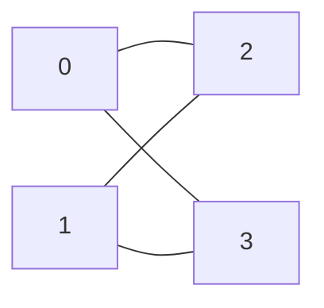
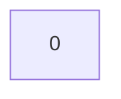
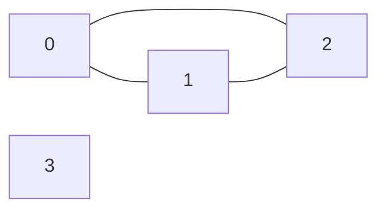
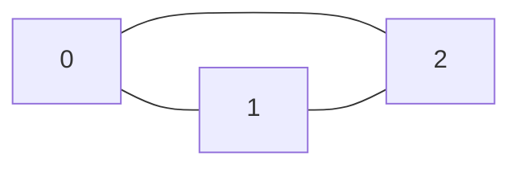
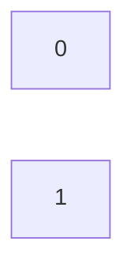

# 当前模型执行与后端验证记录

这是开发会话内非盲测，共13条请求，预期动作/后端状态匹配13条。没有独立解析评分，不据此报告泛化准确率。

验证：19项 pytest 测试通过；Skill 格式验证通过。

## L01

每个连通二分图都是树，搜索1到5个顶点。

模型决策：`{"action": "search", "task": {"premises": ["connected", "bipartite"], "conclusion": "tree", "min_nodes": 1, "max_nodes": 5, "search_mode": "exhaustive"}}`

实际后端状态：`counterexample_found`。

实际检查 42 张图；满足全部前提 14 张；穷举完成：False。

程序证据：`{"degrees": {"0": 2, "1": 2, "2": 2, "3": 2}, "components": [[0, 1, 2, 3]], "bipartition": [[0, 1], [2, 3]], "cycle": [1, 2, 0, 3, 1], "odd_degree_vertices": [], "leaves": [], "node_count": 4, "edge_count": 4}`

逐项核验：`{"graph_structure_valid": true, "node_count_in_range": true, "premises": {"connected": true, "bipartite": true}, "conclusion": {"tree": false}, "all_premises_satisfied": true, "conclusion_violated": true, "is_counterexample": true}`

最小性：`{"vertex_minimum_in_scope": true, "edge_minimum_at_minimum_vertices": false, "scope": [1, 5], "reason": "Increasing-size exhaustive enumeration excludes every smaller order in scope."}`

## L02

图既连通又能二染色，就一定是树吗？查1至5点。

模型决策：`{"action": "search", "task": {"premises": ["connected", "bipartite"], "conclusion": "tree", "min_nodes": 1, "max_nodes": 5, "search_mode": "exhaustive"}}`

实际后端状态：`counterexample_found`。

实际检查 42 张图；满足全部前提 14 张；穷举完成：False。

程序证据：`{"degrees": {"0": 2, "1": 2, "2": 2, "3": 2}, "components": [[0, 1, 2, 3]], "bipartition": [[0, 1], [2, 3]], "cycle": [1, 2, 0, 3, 1], "odd_degree_vertices": [], "leaves": [], "node_count": 4, "edge_count": 4}`

逐项核验：`{"graph_structure_valid": true, "node_count_in_range": true, "premises": {"connected": true, "bipartite": true}, "conclusion": {"tree": false}, "all_premises_satisfied": true, "conclusion_violated": true, "is_counterexample": true}`

最小性：`{"vertex_minimum_in_scope": true, "edge_minimum_at_minimum_vertices": false, "scope": [1, 5], "reason": "Increasing-size exhaustive enumeration excludes every smaller order in scope."}`

## L03

检查逆命题：每棵树都是连通二分图。

模型决策：`{"action": "search", "task": {"premises": ["tree"], "conclusion": {"or": [{"predicate": "connected", "negated": true}, {"predicate": "bipartite", "negated": true}], "negated": true}, "min_nodes": 1, "max_nodes": 5, "search_mode": "exhaustive"}}`

实际后端状态：`verified_true_in_scope`。

实际检查 1099 张图；满足全部前提 146 张；穷举完成：True。

## L04

每个连通图都不是二分图。

模型决策：`{"action": "search", "task": {"premises": ["connected"], "conclusion": {"predicate": "bipartite", "negated": true}, "min_nodes": 1, "max_nodes": 5, "search_mode": "exhaustive"}}`

实际后端状态：`counterexample_found`。

实际检查 1 张图；满足全部前提 1 张；穷举完成：False。

程序证据：`{"degrees": {"0": 0}, "components": [[0]], "bipartition": [[0], []], "cycle": null, "odd_degree_vertices": [], "leaves": [], "node_count": 1, "edge_count": 0}`

逐项核验：`{"graph_structure_valid": true, "node_count_in_range": true, "premises": {"connected": true}, "conclusion": {"not bipartite": false}, "all_premises_satisfied": true, "conclusion_violated": true, "is_counterexample": true}`

最小性：`{"vertex_minimum_in_scope": true, "edge_minimum_at_minimum_vertices": false, "scope": [1, 5], "reason": "Increasing-size exhaustive enumeration excludes every smaller order in scope."}`

## L05

含环或者完全的图都是连通图。

模型决策：`{"action": "search", "task": {"premises": [{"or": ["has_cycle", "complete"]}], "conclusion": "connected", "min_nodes": 1, "max_nodes": 5, "search_mode": "exhaustive"}}`

实际后端状态：`counterexample_found`。

实际检查 23 张图；满足全部前提 4 张；穷举完成：False。

程序证据：`{"degrees": {"0": 2, "1": 2, "2": 2, "3": 0}, "components": [[0, 1, 2], [3]], "bipartition": null, "cycle": [1, 0, 2, 1], "odd_degree_vertices": [], "leaves": [], "node_count": 4, "edge_count": 3}`

逐项核验：`{"graph_structure_valid": true, "node_count_in_range": true, "premises": {"(has_cycle or complete)": true}, "conclusion": {"connected": false}, "all_premises_satisfied": true, "conclusion_violated": true, "is_counterexample": true}`

最小性：`{"vertex_minimum_in_scope": true, "edge_minimum_at_minimum_vertices": false, "scope": [1, 5], "reason": "Increasing-size exhaustive enumeration excludes every smaller order in scope."}`

## L06

最小度至少2的图一定有叶子。

模型决策：`{"action": "search", "task": {"premises": [{"predicate": "min_degree_at_least", "k": 2}], "conclusion": "has_leaf", "min_nodes": 1, "max_nodes": 5, "search_mode": "exhaustive"}}`

实际后端状态：`counterexample_found`。

实际检查 11 张图；满足全部前提 1 张；穷举完成：False。

程序证据：`{"degrees": {"0": 2, "1": 2, "2": 2}, "components": [[0, 1, 2]], "bipartition": null, "cycle": [1, 0, 2, 1], "odd_degree_vertices": [], "leaves": [], "node_count": 3, "edge_count": 3}`

逐项核验：`{"graph_structure_valid": true, "node_count_in_range": true, "premises": {"min_degree_at_least(2)": true}, "conclusion": {"has_leaf": false}, "all_premises_satisfied": true, "conclusion_violated": true, "is_counterexample": true}`

最小性：`{"vertex_minimum_in_scope": true, "edge_minimum_at_minimum_vertices": false, "scope": [1, 5], "reason": "Increasing-size exhaustive enumeration excludes every smaller order in scope."}`

## L07

把“连通二分图都是树”的连通条件删去，其他不变。

模型决策：`{"action": "search", "task": {"premises": ["bipartite"], "conclusion": "tree", "min_nodes": 1, "max_nodes": 5, "search_mode": "exhaustive"}}`

实际后端状态：`counterexample_found`。

实际检查 2 张图；满足全部前提 2 张；穷举完成：False。

程序证据：`{"degrees": {"0": 0, "1": 0}, "components": [[0], [1]], "bipartition": [[0, 1], []], "cycle": null, "odd_degree_vertices": [], "leaves": [], "node_count": 2, "edge_count": 0}`

逐项核验：`{"graph_structure_valid": true, "node_count_in_range": true, "premises": {"bipartite": true}, "conclusion": {"tree": false}, "all_premises_satisfied": true, "conclusion_violated": true, "is_counterexample": true}`

最小性：`{"vertex_minimum_in_scope": true, "edge_minimum_at_minimum_vertices": false, "scope": [1, 5], "reason": "Increasing-size exhaustive enumeration excludes every smaller order in scope."}`

## L08

每棵树都是连通图。

模型决策：`{"action": "search", "task": {"premises": ["tree"], "conclusion": "connected", "min_nodes": 1, "max_nodes": 5, "search_mode": "exhaustive"}}`

实际后端状态：`verified_true_in_scope`。

实际检查 1099 张图；满足全部前提 146 张；穷举完成：True。

## L09

1至3个点，最小度至少3的图都是树。

模型决策：`{"action": "search", "task": {"premises": [{"predicate": "min_degree_at_least", "k": 3}], "conclusion": "tree", "min_nodes": 1, "max_nodes": 3, "search_mode": "exhaustive"}}`

实际后端状态：`verified_true_in_scope`。

实际检查 11 张图；满足全部前提 0 张；穷举完成：True。

范围内没有图满足全部前提，命题真空成立。

## L10

欧拉图一定有欧拉路径吗？

模型决策：`{"action": "clarify", "reason": "请明确欧拉图、路径是否允许闭合，以及孤立点约定。"}`

请明确欧拉图、路径是否允许闭合，以及孤立点约定。

## L11

允许零个顶点，每个图都是树吗？

模型决策：`{"action": "clarify", "reason": "请明确空图的连通性及树的约定。"}`

请明确空图的连通性及树的约定。

## L12

每个有向连通图都是树吗？

模型决策：`{"action": "unsupported", "reason": "后端仅支持有限简单无向图。"}`

后端仅支持有限简单无向图。

## L13

验证三角形是否反驳连通二分图都是树。

模型决策：`{"action": "verify", "task": {"premises": ["connected", "bipartite"], "conclusion": "tree", "min_nodes": 1, "max_nodes": 5}, "graph": {"nodes": [0, 1, 2], "edges": [[0, 1], [1, 2], [0, 2]]}}`

实际后端状态：`inconclusive`。
